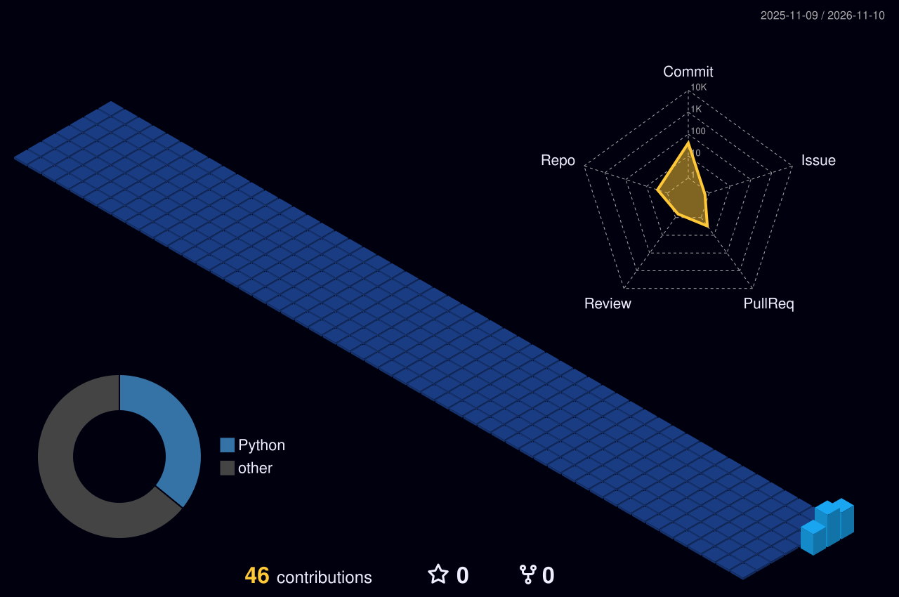

 

---

##  About Me

- 💻 Passionate about software development and technology
- ☁️ Exploring AWS, Cloud Architecture and DevOps
- 🐍 Working with Python and JavaScript
- 🏗️ Building real-world applications and deployment architectures
- 🔍 Interested in automation, scalable systems and AI

 

##  Tech Stack

  

## 🧊 3D Contribution Graph

## 📊 GitHub Statistics

 

 

 

## 🐍 Contribution Snake

<picture>
  <source media="(prefers-color-scheme: dark)" srcset="https://raw.githubusercontent.com/namananand644-test/namananand644-test/output/github-contribution-grid-snake-dark.svg" />
  
</picture>

## 🌐 Connect With Me

### ⚡ Keep Building. Keep Learning. Keep Growing.

*Thanks for visiting my profile!*

